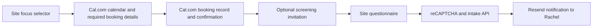

# Calendar-first free screening booking

> Historical calendar-first implementation. Current screening delivery and form behavior are documented in [Screening redirect after booking](email-follow-up.md); that document supersedes the optional questionnaire and email-delivery guidance below.

> **Status:** Proposed for review

## 1. Executive summary

Visitors currently have to finish a long questionnaire before seeing appointment times. The new flow lets them choose a time, provide essential contact details, choose in-person or virtual sessions, and accept the guarantee and waiver to complete their booking. Only then are they invited to answer optional screening questions, strongly recommended to help Rachel prepare. Keep Cal.com as the booking system and reuse the site's questionnaire and email delivery. The main cost is maintaining required booking fields and agreement text across four Cal.com event types as well as the site's optional questionnaire.

## 2. Context and scope

Review performed October 4, 2026 against repository commit `37806d9` and public booking pages. No implementation or vendor settings were changed. Existing untracked handoff notes and screenshot were left untouched. No AGENTS.md or ARCHITECTURE.md was found in the inspected repository tree.

### Current structure, stack, and CSS

| Area | Verified setup | Implication |
| --- | --- | --- |
| Application | Next.js 16.1.6 App Router, React 19.2.3, TypeScript; npm lockfile | Existing application can handle this change without a new framework. |
| Routes | Home, about, contact, service index and nine service pages; server routes `/api/intake` and `/api/contact` | Booking is shared across pages rather than owned by `/contact`. |
| Shared layout | `app/layout.tsx` renders navigation, breadcrumbs, page content, `ContactForm`, footer, and structured data | All current booking CTAs reach `#contact-form`. Preserve that anchor. |
| Forms | `ContactForm` contains `FreeScreeningBooking` plus a separate collapsible message form | Only the screening flow needs reordering. |
| Field definitions | `lib/intake.ts` defines four focus choices; stress and other share a questionnaire; `withIds` defaults fields to required | Both displayed fields and server validation must change. |
| Styling | Tailwind CSS 4, inline utility classes, global theme tokens and custom glow/animation utilities | Reuse sage, forest, cream, rounded cards and existing controls; no CSS redesign. |
| Typography/motion | Google Fonts imports for Marcellus and IBM Plex Sans; Framer Motion; Lucide icons | README's Geist claim is stale. Existing reduced-motion CSS does not by itself prove JS motion is reduced. |
| Form libraries | React Hook Form, Zod and resolvers used by general contact form; intake uses React state and native controls | Do not rewrite the intake into another form framework. |
| Hosting | Vercel tooling and local project metadata present | Actual account ownership, deployment parity, DNS and connected calendar settings require account verification. |

### Current booking sequence and findings

`CTA → #contact-form → focus → full intake → reCAPTCHA → /api/intake → two Resend sends → calendar iframe → Cal.com booking`.

The calendar is rendered only when intake status becomes `success`. Most questionnaire fields are mandatory, including health and personal-history questions. Answers are persisted without expiry in `localStorage` under `rewire-intake-progress-v1`, and cleared when intake submission succeeds, before booking. The API validates required fields and email but accepts any nonempty consent value and does not validate radio values against their allowed options. It awaits Resend calls without checking returned error objects, so the success UI is not reliable proof of email acceptance.

The public weight-loss booking details were inspected after selecting a slot, without entering personal data or confirming. They show name, email, a required free-text location labelled “As indicated in intake form,” optional notes, and guests. Phone, guarantee and waiver were not visible. Weight-loss and smoking event pages show one-hour duration and that same intake-dependent location. Other event settings, connected calendar provider, reminders and video integration have not been inspected. `HowItWorksSection` describes a 30-minute screening, creating a duration inconsistency.

The repository has no active Google Forms integration despite a legacy comment. General contact email copy incorrectly promises questionnaire redirection, although the client does not redirect. Handoff notes incorrectly say analytics is absent. These copy errors should be corrected in the touched booking documentation and message email, without widening this into a whole-site rewrite.

Scope is the existing free screening booking flow, all four event types, optional questionnaires, related emails and accurate journey copy. Paid appointments are not represented by the inspected flow.

## 3. System context

| Third party | Current responsibility and boundary |
| --- | --- |
| Cal.com | Four public event URLs under `rewirehypnosis`; availability, booking records, appointment confirmation and calendar invitations. Site has no booking API, database, webhook or verified booking state. |
| Resend | Intake notification to `rachel@rewirehypnosis.ca` and intake receipt to visitor. General messages also notify a secondary Gmail address. Not the appointment scheduler. |
| Google reCAPTCHA v3 | Loaded on submission; server checks action, hostname and score ≥ 0.5 for site forms. Does not guard direct Cal.com bookings. |
| Vercel | Hosting target and Next.js runtime; production configuration not audited. |
| Google Analytics | Global `gtag` script with measurement ID `G-GMZMEJRNJS`. No booking completion listener found. |
| Google Fonts / Maps | Remote typography and embedded location maps; no booking state ownership. |
| Instagram | Global embed script; no booking responsibility found. |
| Zoom / calendar provider | Zoom appears in preference labels. Actual Cal.com integrations and connected calendar provider remain unverified. |

The changed boundary moves required booking details and consents from the site's intake API to Cal.com. Detailed optional answers continue through the site to Resend, rather than being placed in calendar invitations.

## 4. Proposed design

### How it works

A visitor chooses Weight Loss solely to route to the right event. The calendar appears immediately, without an intake submission. They select a time, then enter their name, email and phone, select in-person or virtual sessions, and explicitly accept the two agreements. Cal.com creates the appointment and handles its confirmation. Selecting a slot alone is not a completed booking.

Use Cal.com's native booking questions for the required fields. Keep email confirmation enabled and add phone as an additional required question. Replace the intake-dependent location with a required two-option choice and ensure the appointment's location/meeting instructions agree with it. No option or consent is preselected. Display the complete existing service-specific waiver and shared guarantee, or accessible full-text links adjacent to clearly named acceptance controls, before confirmation. Preserve their current wording in this change.

Use Cal.com's official inline embed script instead of the bare iframe so the supported `bookingSuccessfulV2` event can reveal the optional screening panel. This event can describe an unconfirmed booking; inspect its status and use “request received” for pending requests. Do not infer success from selecting a time, iframe load, or the Confirm click. Keep Cal.com's confirmation and cancellation/reschedule controls accessible.

After success, show: “Your booking is complete. Screening questions are optional, but highly recommended so Rachel can prepare for your appointment.” Provide equally clear “Complete screening questions” and “Skip for now” actions. For a pending request, change the first sentence to “Your booking request was received.” Skipping has no effect on the appointment. The questionnaire accepts any subset of answers. Blank optional responses are omitted from the notification.

Provide a reusable `/screening?serviceId=weight-loss` page for later completion and direct-Cal visitors. Include its service-specific link in each Cal.com confirmation message if account settings permit. Do not rely on redirect behavior or send personal details in the link. On this page, ask for the same name and booking email only when submitting, so Rachel can match the answers manually. These are identification fields, not mandatory screening questions. Explain that submitting this form does not book, cancel or change an appointment. Do not render another booking widget on this page.

### Components and responsibilities

`FreeScreeningBooking` owns focus selection, embed display and post-booking invitation. It does not own availability, agreement enforcement or appointment creation. `lib/intake.ts` owns reusable question definitions and service-to-event mapping, not booking status. Extract the existing questionnaire renderer only as needed for reuse by the booking panel and `/screening`; do not build a generic form engine.

The optional questionnaire and `/api/intake` own answer validation and notification delivery, not appointment validity. `ContactForm` retains general enquiries and the shared booking anchor, but its booking section is suppressed on `/screening`. Cal.com settings own the required contact/location/consent fields for embedded and direct bookings. Root/global CSS remains the shared visual system.

### Decisions

Cal.com must enforce required booking fields because a site-only gate is bypassed by direct event links. This avoids a custom scheduler, reservation database and booking webhook. The cost is duplicated settings across four events and account-level verification before release. Native required questions are documented in [Cal.com booking questions](https://cal.com/help/event-types/booking-questions); acceptance-control types and long-text presentation still require an account check.

Use the [official embed event](https://cal.com/help/embedding/embed-events) rather than a custom cross-origin message parser. No new npm package is needed. The event improves the immediate handoff but is only a UI signal, not authenticated server evidence. An absent callback must never make a real booking invalid.

Only contact details, session preference and the two agreements are required to book. Every remaining intake question is optional, including date, address and health questions. Remove “Which level of investment feels realistic for you right now?” and its amount options from every questionnaire. Keep the separate financial/emotional readiness question optional, since removal of that question was not requested.

Do not persist health answers in browser storage in the new flow. Remove the old progress entry when mounting the new booking UI and do not restore it into the new schema. Retain current-tab answers after a failed submission. The cost is losing unsent answers on reload; the benefit is avoiding indefinite health-data storage on shared devices without adding an expiry subsystem.

## 5. Invariants and requirements

### Invariants

- `INV-1`: Calendar access never depends on questionnaire submission, reCAPTCHA or Resend.
- `INV-2`: A completed booking requires name, valid email, phone, one session preference, and explicit acceptance of both current agreements, including on direct Cal.com links.
- `INV-3`: Skipping, partially answering or failing to submit screening questions never cancels or invalidates a booking.
- `INV-4`: No questionnaire contains the investment-amount question or its options.
- `INV-5`: The site claims booking success only from a Cal.com success signal, with wording appropriate to its status.
- `INV-6`: Detailed answers and contact values never enter analytics events or screening-link query parameters; health answers are not persisted in browser storage.
- `INV-7`: The intake API validates recognized service IDs, known field IDs, allowed choice values and bounded string input before email delivery, and reports provider rejection as failure.

### Requirements

The mandatory screening-location choice must offer “In person at the clinic, 257 Division Street, Cobourg, unit 104” and “Virtual over Zoom.” This choice describes the screening itself and must determine the invitation's location and meeting instructions. Every free screening event type must have a 60-minute duration, and related site copy must say 60 minutes. Preserve all four focus routes and existing CTA targets. Use labelled native controls, visible required markers, keyboard focus, accessible errors and status announcements. Respect reduced motion in any changed animation. Validate text contrast in the changed panel; existing muted gray on cream and white on sage merit checking rather than assuming compliance.

## 6. Interfaces and data

Keep `/api/intake` POST with `{ serviceId, responses, recaptchaToken }` for compatibility. Define explicit stable identifiers for contact fields and `session-preference`, `waiver-agreement`, `guarantee-agreement` in Cal.com. New optional submission requires name and email for matching, but never asks for phone, location or agreement acceptance again. Remove those booking-owned fields from the questionnaire renderer and email rows. Preserve existing optional question IDs so copy changes do not silently change their identity.

The API should reject invalid service IDs with 400 using an own-property/allowlist check, validate JSON shape, limit the body to 64 KiB, name to 200 characters, email to 254, and individual answers to 4,000. Unknown response keys are discarded, including legacy investment answers. Empty questionnaires do not send an email; the user can skip instead. Optional radio/scale/date values are validated when supplied. Invalid or oversized input returns 400 or 413; reCAPTCHA failure returns 403; unavailable email service returns 503.

Check Resend's returned error for Rachel's notification before returning success. Visitor receipt failure after Rachel's accepted notification must not ask the visitor to resubmit and create a duplicate. Log a sanitized delivery failure and show that answers were received. Update intake emails to say booking is separate and questions are optional; remove “you can now choose a time.” Correct general enquiry emails' false redirection wording.

### Naming and identity

Focus IDs remain the existing four `IntakeServiceId` values, mapped to existing Cal.com slugs and environment overrides. Cal.com creates booking UIDs. The optional API does not require or authenticate a booking UID and cannot prove that the submitter has an appointment. Name, email and focus are self-reported matching context for Rachel; do not claim an automatic verified association. Missing name/email prevents questionnaire submission, but does not affect any booking. Renaming an event slug requires updating its mapping and follow-up link together; existing appointments remain owned by Cal.com.

## 7. Failure behavior and lifecycle

If Cal.com fails to load or emits `linkFailed`, show a direct event link and contact fallback. After 15 seconds without readiness, show those fallbacks while allowing the embed to continue loading. Availability and slot conflicts remain Cal.com's responsibility. If no success callback arrives, keep the calendar visible and provide the standalone questionnaire link as an optional fallback, without asserting success. Duplicate callbacks must not reset answers or send email. Switching focus before booking resets the embed and removes its listener; after success, keep the booked focus fixed for the optional panel.

Submit-time reCAPTCHA or email failure retains answers in the current tab and enables manual retry. Set a 15-second request timeout for each external verification/email call; do not automatically retry sends after an ambiguous timeout. Explain that delivery could not be confirmed and provide the contact fallback. A successful notification clears answers. Reload does not restore them.

Release requires Cal.com fields to be configured and checked on all four events before removing the site's intake gate. Rollback must retain those fields, so direct bookings remain protected. Existing appointments and already emailed intakes are untouched. Public Next.js config changes require a rebuild; unmount removes embed listeners. No worker or queued job is introduced.

## 8. Security, privacy, and operations

Cal.com is authoritative for booking records and required acceptance. The browser callback and optional questionnaire identity are untrusted. Keep Google verification on optional submissions and existing hostname/action checks; do not add a webhook, authentication service or database just for matching answers. Escape email HTML and avoid logging answers, email addresses or full vendor responses. Health answers go only to Rachel's current intake notification recipient, not the secondary general-contact Gmail recipient or Cal.com calendar notes.

Each optional submission uses one reCAPTCHA verification and at most two Resend sends. Double-submit prevention is required. Vendor quotas and production request limits are not known; quota rejection must produce the delivery failure behavior above, with no automatic loop. Intake retention currently depends on email inboxes; new booking contact and consent retention depends on Cal.com. Record the account owners and retention policies before launch. Do not expose server secrets; public Cal.com URLs are configuration, not credentials.

## 9. Acceptance criteria

- `AC-1`: All existing CTAs reach a calendar after focus selection, with no intake or email prerequisite.
- `AC-2`: Embedded and direct booking forms for every focus reject missing contact details, preference or either acceptance; full agreement text is accessible before confirmation.
- `AC-3`: After a successful booking, a clearly optional, strongly recommended questionnaire appears with a skip action; skipping leaves the appointment intact.
- `AC-4`: A questionnaire with one answer submits successfully; unanswered screening questions do not cause validation errors. The investment-amount field is absent from all four forms and outgoing rows.
- `AC-5`: The session preference options and actual invitation instructions agree, using the confirmed address and verified virtual setup.
- `AC-6`: Invalid input, reCAPTCHA rejection, Resend error objects and external timeouts show accurate failure states without losing current-tab answers or affecting booking.
- `AC-7`: A standalone screening link works after reload and on another device, asks only for matching identity when sending, and never implies it creates a booking.
- `AC-8`: Changed UI works at 375 px width and with keyboard/reduced motion; errors and status changes are announced; no stale local intake is restored.
- `AC-9`: Intake, enquiry and booking copy accurately describes the new sequence and 60-minute screening duration; all four Cal.com event types are configured for 60 minutes.

## 10. Test approach

Use one focused automated contract check for the four field sets and API validation/provider failures, covering `INV-4`, `INV-7`, `AC-4` and `AC-6`. Mock external sends, including returned error objects, accepted Rachel notification followed by receipt failure, and timeout. Do not send real health data in tests.

Browser verification covers all focus paths, blocked/missing vendor scripts, success versus pending callback wording, duplicate callbacks, skipping, stale storage, partial forms, direct links and standalone follow-up (`INV-1` through `INV-6`, `AC-1` through `AC-9`). Verify mandatory fields in Cal.com's account/test environment and inspect one authorized test confirmation for each event; a mock embed cannot prove vendor enforcement. Run existing lint and production build after implementation. No tests run for this documentation-only proposal.

## 11. Risks and tradeoffs

- Cal.com account settings might not support suitable consent controls, readable full agreement text, or the desired follow-up link. Verify these before implementation; do not silently replace required acceptance with a nonempty text field.
- Fewer questionnaires may reach Rachel. Clear recommendation and a reusable follow-up link reduce that cost without reintroducing a gate.
- Agreement copies can drift across event types. Record the deployed text revision in the handoff and inspect every event on updates.
- Optional answers are matched manually, not cryptographically linked to a booking. This is adequate for preparation; add verified linkage only if automatic processing becomes necessary.

## 12. Open questions

Confirmed by the user after the initial review: address is 257 Division Street, Cobourg, unit 104; the required choice is the screening location; duration is 60 minutes. These decisions are incorporated into the requirements and acceptance criteria.

- **Account capability, blocks implementation choice:** Verify required acceptance controls, complete agreement presentation, confirmation follow-up links, four event settings and connected calendar/video services. Public pages alone cannot establish these.
- **Investment wording, nonblocking:** Keep the separate readiness-to-invest question optional by default. Remove only the amount question requested.
- **Retention, blocks launch readiness:** Confirm Cal.com and Rachel's email retention policies with the account owner; the repo does not define them.

Review pass complete: current/proposed boundaries, identity limits, resource bounds, errors, lifecycle, privacy, acceptance criteria and test coverage checked. Remaining gaps are stated above. The design is ready for review; vendor capability must be verified before implementation is finalized. Address, location meaning and duration are resolved.

## 13. Out of scope

- Paid booking, payments, new CRM, custom scheduler, database, webhook or automated booking-to-intake matching.
- Rewriting waiver/guarantee terms, redesigning all questionnaires, or removing other financial questions without direction.
- Whole-site CSS cleanup, font migration, analytics redesign, vendor ownership transfer or historical intake deletion.
- An implementation task breakdown. The requested design skill stops at the proposed design.
